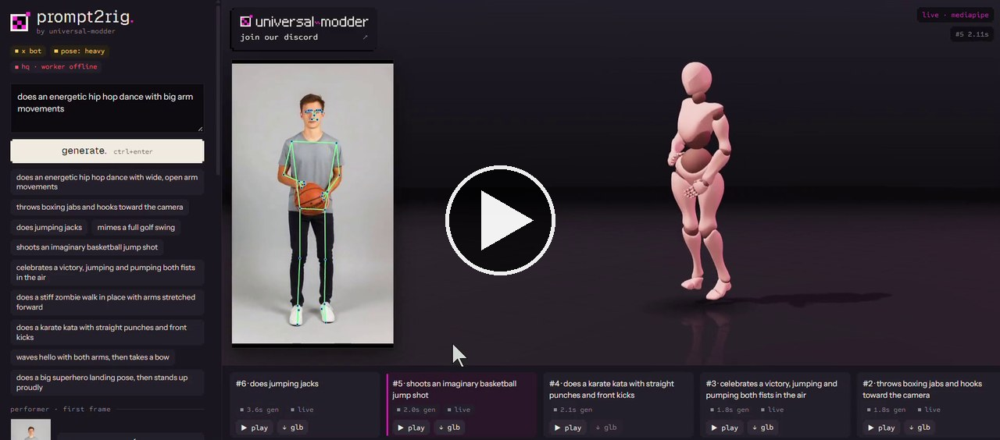

# prompt2rig-demo

A hands-on run of [**prompt2rig**](https://github.com/blendi-remade/prompt2rig) on a Windows laptop (RTX 3050 Laptop GPU, Git Bash): you type a motion, a fast video model acts it out, and a rigged Mixamo character performs it live in the browser.

I found the tool in [Stefan's video](https://www.youtube.com/watch?v=58UpDAnbdkM&t=343s) (the Prompt2Rig chapter starts at 5:43). The original code lives at [blendi-remade/prompt2rig](https://github.com/blendi-remade/prompt2rig) and is not included here. This repo holds only my demo recording, notes, and a small Git Bash wrapper.

## Demo

Click the image to play the video (51 s, live mode, X Bot character, preset prompts such as jumping jacks, a basketball jump shot, and karate kicks):

[](https://az9713.github.io/prompt2rig-demo/prompt2rig_demo2.mp4)

## Live pages (GitHub Pages)

| Page | What it is |
|---|---|
| [Landing page](https://az9713.github.io/prompt2rig-demo/) | Video player plus links to everything below |
| [Demo video (MP4)](https://az9713.github.io/prompt2rig-demo/prompt2rig_demo2.mp4) | The recording, played straight in the browser |
| [Beginner guide](https://az9713.github.io/prompt2rig-demo/prompt2rig_beginner_guide.html) | Setup tiers 0 to 3 and the 10 Windows frictions found in the code |
| [Development journey](https://az9713.github.io/prompt2rig-demo/DEVELOPMENT-JOURNEY.html) | How the demo went, with frame sheets from both recordings |

## The `prompt2rig_reel` wrapper

Git Bash scripts that sit next to a clone of the original repo and smooth over the Windows rough edges. Clone both side by side:

```bash
git clone https://github.com/blendi-remade/prompt2rig prompt2rig-main
git clone https://github.com/az9713/prompt2rig-demo
cp -r prompt2rig-demo/prompt2rig_reel .
cd prompt2rig_reel
```

| File | What it does |
|---|---|
| `config.sh` | Settings: repo path (`../prompt2rig-main`), Blender path, CUDA build (`cu126`, or `cu128` for RTX 50). |
| `doctor.sh` | Checks every prerequisite and prints what's missing. Run it first. |
| `make_env.sh` | Asks for your fal key without echoing it and writes `.env` as plain UTF-8 without quotes (PowerShell 5.1's `>` writes UTF-16, which the server can't parse). |
| `setup_hq.sh` | One-time HQ setup: runs `hq/setup.ps1`, then verifies torch, CUDA and GVHMR actually import, since the .ps1 can fail without stopping. `--hands <zip>` adds finger tracking. |
| `run.sh` | Starts the web app plus the HQ worker and opens the browser. `--live` starts the app only. |
| `prompts.txt` | Four reel prompts. |
| `render_reel.sh` | Blender side-by-side render of every `takes/*_hq.glb`, joined into `reel.mp4`. `--preview` is fast. |
| `metrics.py` | Live vs HQ motion quality: angular jerk, foot skate, hips acceleration, bone-length stretch. Needs only numpy. |

Quick start (no GPU needed):

```bash
./doctor.sh
./make_env.sh
./run.sh --live
```

The full walkthrough, including the HQ (GVHMR) path, is in the [beginner guide](https://az9713.github.io/prompt2rig-demo/prompt2rig_beginner_guide.html).

## Credits and licenses

- prompt2rig is by [blendi-remade](https://github.com/blendi-remade/prompt2rig) (universal-modder), Apache-2.0.
- Its HQ path pulls in GVHMR, SMPL-X, WiLoR and MANO, which are licensed for non-commercial use only.
- Every generation is a paid [fal](https://fal.ai) call. Keys go in `.env`, which this repo never commits.
